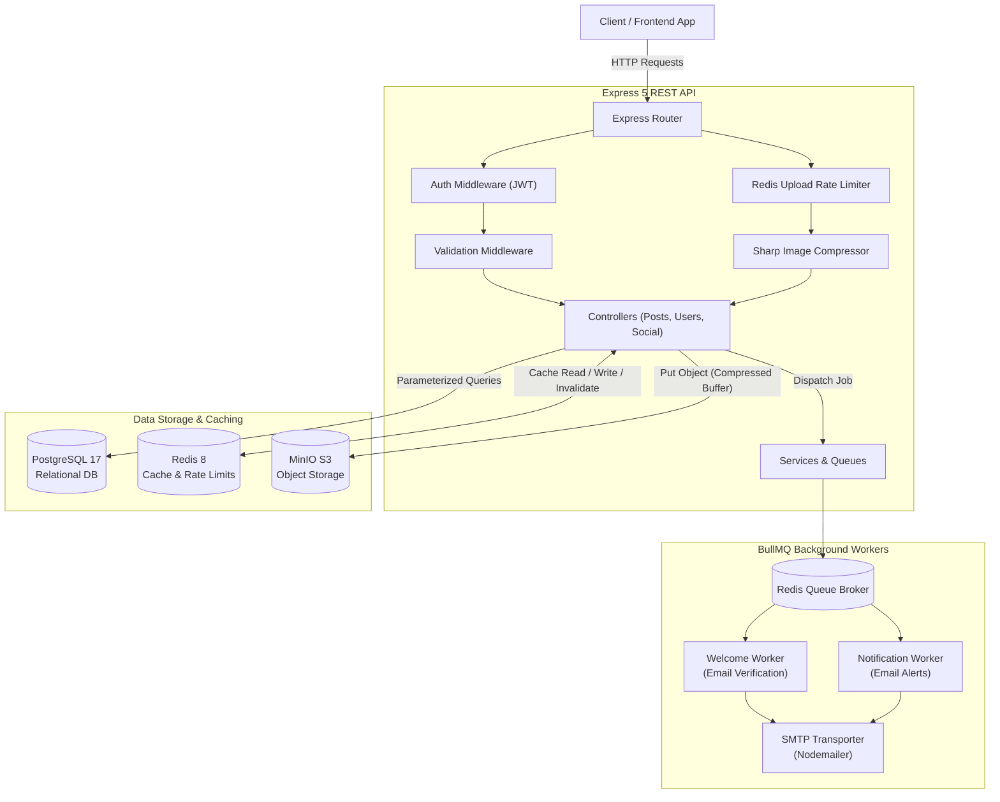
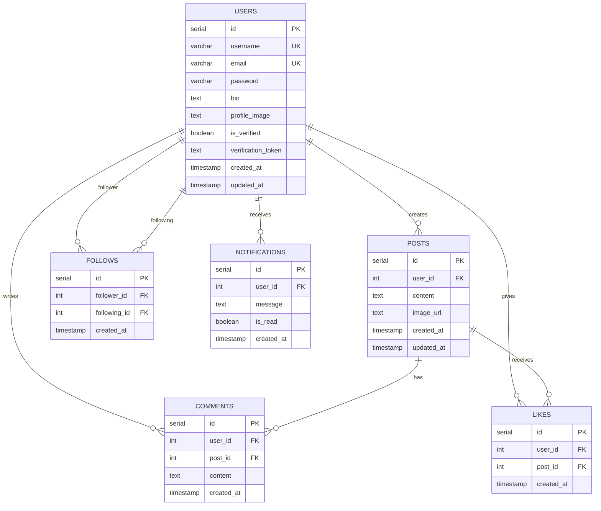

# 📱 Social Media Backend API

[](https://nodejs.org/)
[](https://expressjs.com/)
[](https://www.postgresql.org/)
[](https://redis.io/)
[](https://docs.bullmq.io/)
[](https://min.io/)
[](https://www.docker.com/)
[](https://opensource.org/licenses/ISC)

A scalable, containerized RESTful API backend engineered for a social media platform. Built with **Node.js (ES Modules)**, **Express 5**, and **PostgreSQL**, leveraging **Redis** for distributed caching and rate-limiting, **BullMQ** for asynchronous background worker jobs, and **MinIO (S3-compatible)** paired with **Sharp** for image compression and object storage.

---

## 📑 Table of Contents

- [Architectural Overview](#-architectural-overview)
- [Key Engineering Highlights](#-key-engineering-highlights)
- [System Architecture](#-system-architecture)
- [Tech Stack](#-tech-stack)
- [Database Schema & ERD](#-database-schema--erd)
- [Getting Started](#-getting-started)
  - [Prerequisites](#prerequisites)
  - [Option 1: Quickstart with Docker Compose (Recommended)](#option-1-quickstart-with-docker-compose-recommended)
  - [Option 2: Manual Local Setup](#option-2-manual-local-setup)
- [Environment Variables](#-environment-variables)
- [API Reference](#-api-reference)
  - [Authentication & User Management](#1-authentication--user-management)
  - [Post Management & Search](#2-post-management--search)
  - [Media Upload & Image Processing](#3-media-upload--image-processing)
  - [Comments](#4-comments)
  - [Likes & Engagement](#5-likes--engagement)
  - [Follows & Social Graph](#6-follows--social-graph)
  - [Activity Feed](#7-activity-feed)
  - [Notifications](#8-notifications)
- [Directory Structure](#-directory-structure)
- [Security & Performance Optimizations](#-security--performance-optimizations)
- [Roadmap & Future Enhancements](#-roadmap--future-enhancements)
- [License](#-license)

---

## 🏛 Architectural Overview

The backend follows a layered MVC-style service architecture emphasizing separation of concerns, asynchronous processing, and high read throughput:

1. **Routing & Middleware Layer**: Handles HTTP requests, enforces JWT stateless authentication, validates incoming JSON bodies with `express-validator`, applies rate limits, and processes multipart file buffers.
2. **Controller Layer**: Orchestrates business logic, parses query/route parameters, interfaces with models, triggers asynchronous event queues, and delivers standardized JSON responses.
3. **Model / Persistence Layer**: Uses direct parameterized queries via the `pg` connection pool to eliminate SQL injection vulnerabilities and maintain minimal ORM overhead.
4. **Caching Layer (Cache-Aside)**: Redis caches paginated post listings with deterministic cache keys (`posts:<page>:<limit>`), invalidating cache entries upon post creation, modification, or deletion.
5. **Asynchronous Background Processing**: Email verification and event notifications (comments, likes, follows) are decoupled from the HTTP request-response cycle using BullMQ queues backed by Redis workers.
6. **Object Storage & Media Pipeline**: Multer captures uploads in memory (`memoryStorage`), Sharp optimizes and compresses images (converting/compressing to JPEG, PNG, or WebP), and the MinIO SDK streams the processed binary payload to an S3 bucket.

---

## 🚀 Key Engineering Highlights

- **Decoupled Asynchronous Tasks**: Welcome emails with UUID-based verification tokens and notification emails are queued in BullMQ, ensuring zero blocking on API endpoints.
- **Cache-Aside Pattern with Invalidation**: Redis caches high-traffic paginated feed/post queries. Cache keys are cleared atomically (`del keys`) on mutation endpoints (`POST`, `PUT`, `DELETE /api/posts`).
- **Distributed Upload Rate Limiter**: Redis-based rate limiting restricts media uploads to 5 uploads per hour per user using `SET ... EX` and `INCR`.
- **On-the-Fly Image Optimization**: Images larger than 1MB are automatically compressed using `sharp` (quality 80 for JPEG/WebP, compression level 9 for PNG) before reaching storage.
- **Relational Integrity**: Complete schema with foreign key constraints, `ON DELETE CASCADE`, composite unique constraints (preventing duplicate likes and mutual follow collisions), and performance indexes on foreign keys and timestamps.
- **Containerized Infrastructure**: Complete multi-container orchestration (`app`, `postgres`, `redis`, `minio`) with health checks, persistent volumes, and automated DDL schema initialization.

---

## 📊 System Architecture



---

## 🛠 Tech Stack

| Technology | Category | Purpose |
| :--- | :--- | :--- |
| **Node.js (v22+)** | Runtime | Server-side JavaScript execution environment (ES Modules) |
| **Express.js (v5.2)** | Web Framework | Routing, middleware orchestration, and HTTP request handling |
| **PostgreSQL (v17)** | Primary Database | Relational data persistence with strict foreign key constraints |
| **pg (node-postgres)** | Database Client | Native connection pooling and parameterized SQL queries |
| **Redis (v8)** | In-Memory Store | Cache-aside query acceleration, upload rate-limiting, and BullMQ backend |
| **BullMQ (v5.8)** | Job Queue | Distributed message queues and background job scheduling |
| **MinIO (v8)** | Object Storage | S3-compatible cloud storage for post and profile image media |
| **Sharp (v0.35)** | Media Processing | High-performance image resizing, format detection, and compression |
| **Multer (v2.2)** | Multipart Parser | In-memory file buffer parsing for media uploads |
| **Nodemailer (v9)** | Email Client | SMTP email delivery for account verification and user alerts |
| **jsonwebtoken (JWT)** | Authentication | Stateless authentication tokens for protected routes |
| **bcrypt (v6)** | Security | Adaptive salted password hashing (10 salt rounds) |
| **express-validator** | Validation | Declarative request payload validation and sanitization |
| **Docker & Compose** | Containerization | Reproducible local & production environment orchestration |

---

## 🗄 Database Schema & ERD

The database schema is defined in [`schema.sql`](schema.sql) with full referential integrity and query optimization indexes.



---

## 🏁 Getting Started

### Prerequisites

Ensure you have the following installed on your machine:
- [Git](https://git-scm.com/)
- [Docker](https://www.docker.com/) and [Docker Compose](https://docs.docker.com/compose/)
- *(Optional for bare-metal setup)*: [Node.js](https://nodejs.org/) (v20+ recommended), [PostgreSQL](https://www.postgresql.org/), [Redis](https://redis.io/)

---

### Option 1: Quickstart with Docker Compose (Recommended)

1. **Clone the repository:**
   ```bash
   git clone https://github.com/your-username/social-media-backend.git
   cd social-media-backend
   ```

2. **Configure environment variables:**
   ```bash
   cp .env.example .env
   ```
   *(Update SMTP credentials in `.env` if you want to test email dispatch).*

3. **Spin up all services:**
   ```bash
   docker compose up --build
   ```
   This boots:
   - **Backend API**: `http://localhost:3000`
   - **PostgreSQL**: `localhost:5432` (Auto-runs `schema.sql`)
   - **Redis**: `localhost:6379`
   - **MinIO S3**: `http://localhost:9000` (API) & `http://localhost:9001` (Web Console, user: `admin`, pass: `password123`)

---

### Option 2: Manual Local Setup

1. **Clone and install dependencies:**
   ```bash
   git clone https://github.com/your-username/social-media-backend.git
   cd social-media-backend
   npm install
   ```

2. **Configure environment variables:**
   ```bash
   cp .env.example .env
   # Ensure DB_HOST=localhost, REDIS_HOST=localhost, MINIO_ENDPOINT=localhost in .env
   ```

3. **Initialize the PostgreSQL Database:**
   ```bash
   # Create database
   createdb social_media

   # Run schema migration
   psql -d social_media -f schema.sql
   ```

4. **Ensure Redis and MinIO are running locally:**
   - Redis: Port `6379`
   - MinIO: Port `9000`

5. **Start the development server:**
   ```bash
   npm run dev
   ```

   For production:
   ```bash
   npm start
   ```

---

## 🔐 Environment Variables

The project reads environment variables via `dotenv`. Configure these in your `.env` file:

| Variable | Description | Default / Example | Required |
| :--- | :--- | :--- | :--- |
| `PORT` | HTTP port Express listens on | `3000` | No |
| `APP_URL` | Base URL used for email verification links | `http://localhost:3000` | Yes |
| `DB_HOST` | PostgreSQL hostname / Docker service name | `localhost` or `my-postgres` | Yes |
| `DB_PORT` | PostgreSQL port | `5432` | Yes |
| `DB_USER` | PostgreSQL user | `postgres` | Yes |
| `DB_PASSWORD` | PostgreSQL password | `postgres` | Yes |
| `DB_NAME` | PostgreSQL database name | `social_media` | Yes |
| `JWT_SECRET` | Secret key for signing and verifying JWTs | `secret_key` | Yes |
| `REDIS_HOST` | Redis hostname / Docker service name | `localhost` or `my-redis` | Yes |
| `REDIS_PORT` | Redis port | `6379` | Yes |
| `MINIO_ENDPOINT`| MinIO endpoint hostname | `localhost` or `my-minio` | Yes |
| `MINIO_PORT` | MinIO S3 API port | `9000` | Yes |
| `MINIO_ACCESS_KEY` | MinIO root access key | `admin` | Yes |
| `MINIO_SECRET_KEY` | MinIO root secret key | `password123` | Yes |
| `EMAIL_USER` | Sender Gmail / SMTP email address | `user@gmail.com` | Yes (for emails) |
| `EMAIL_PASS` | SMTP application password | `app_password` | Yes (for emails) |

---

## 📡 API Reference

All protected endpoints require an `Authorization` header formatted as:
```http
Authorization: Bearer <your_jwt_token>
```

### 1. Authentication & User Management

#### Register a new user
```http
POST /api/users/register
Content-Type: application/json

{
  "username": "johndoe",
  "email": "johndoe@example.com",
  "password": "securepassword123"
}
```
- **Status 201 Created**: Queues a welcome email with a verification link to `email`.
- **Validation**: Username required, valid email format, password min length 6 chars.

#### Verify email address
```http
GET /api/users/verify/:token
```
- **Status 200 OK**: Verifies the account and enables login.

#### Login
```http
POST /api/users/login
Content-Type: application/json

{
  "email": "johndoe@example.com",
  "password": "securepassword123"
}
```
- **Status 200 OK**: Returns `{ message: "Login Successful", token: "<jwt_token>" }`.
- **Status 403 Forbidden**: If email is not yet verified.

#### Get current user profile (Auth)
```http
GET /api/users/profile
Authorization: Bearer <token>
```
- **Status 200 OK**: Returns decoded authenticated user payload.

#### Search users
```http
GET /api/users/search?username=john
```
- **Status 200 OK**: Returns list of matching users (`id`, `username`) via case-insensitive pattern matching.

---

### 2. Post Management & Search

#### Create a post (Auth)
```http
POST /api/posts
Authorization: Bearer <token>
Content-Type: application/json

{
  "content": "Hello world! This is my first post.",
  "imageUrl": "http://localhost:9000/posts/sample.png"
}
```
- **Status 201 Created**: Invalidates cached post pages in Redis.
- **Validation**: Content is required and max 500 characters.

#### Fetch paginated posts (Cached)
```http
GET /api/posts?page=1&limit=10
```
- **Status 200 OK**: Returns paginated post listing with author details. Results are cached in Redis under key `posts:<page>:<limit>`.

#### Search posts by text
```http
GET /api/posts/search?content=coding
```
- **Status 200 OK**: Returns list of posts containing query string.

#### Edit a post (Auth - Owner only)
```http
PUT /api/posts/:id
Authorization: Bearer <token>
Content-Type: application/json

{
  "content": "Updated post content."
}
```
- **Status 200 OK**: Updates post, refreshes `updated_at`, and flushes Redis post cache.
- **Status 403 Forbidden**: If the post belongs to another user.

#### Delete a post (Auth - Owner only)
```http
DELETE /api/posts/:id
Authorization: Bearer <token>
```
- **Status 200 OK**: Deletes post, cascades associated comments and likes, and flushes Redis post cache.

---

### 3. Media Upload & Image Processing

#### Upload and compress image (Auth, Rate Limited)
```http
POST /api/upload
Authorization: Bearer <token>
Content-Type: multipart/form-data

[Form field 'image': binary image file (JPEG, PNG, WebP)]
```
- **Middlewares Applied**:
  1. `uploadRateLimit`: Max 5 uploads per hour per user (tracked in Redis).
  2. `upload.single("image")`: Validates file size (max 10MB) and MIME type.
  3. `compressImage`: If file size > 1MB, Sharp compresses the image buffer before transmission.
  4. `uploadImage`: Uploads buffer to MinIO bucket `posts`.
- **Status 200 OK**: Returns `{ message: "Image uploaded successfully", imageUrl: "..." }`.
- **Status 429 Too Many Requests**: If 5 uploads exceeded in a 1-hour window.

---

### 4. Comments

#### Add a comment to a post (Auth)
```http
POST /api/comments/:id
Authorization: Bearer <token>
Content-Type: application/json

{
  "content": "Awesome post!"
}
```
- **Status 201 Created**: Inserts comment and dispatches background email notification to post owner (if author != post owner).
- **Validation**: Max 300 characters.

#### Get all comments for a post
```http
GET /api/comments/:id
```
- **Status 200 OK**: Returns chronologically ordered comments with commenter usernames.

#### Delete a comment (Auth - Owner only)
```http
DELETE /api/comments/:id
Authorization: Bearer <token>
```
- **Status 200 OK**: Deletes comment. Enforces ownership check.

---

### 5. Likes & Engagement

#### Like a post (Auth)
```http
POST /api/likes/:postId
Authorization: Bearer <token>
```
- **Status 201 Created**: Registers like and sends email notification to post author.
- **Status 400 Bad Request**: If user has already liked the post (preventing duplicate likes).

#### Unlike a post (Auth)
```http
DELETE /api/likes/:postId
Authorization: Bearer <token>
```
- **Status 200 OK**: Removes like record.

#### Get post like count
```http
GET /api/likes/:postId
```
- **Status 200 OK**: Returns `{ "total_likes": "<count>" }`.

---

### 6. Follows & Social Graph

#### Follow a user (Auth)
```http
POST /api/follows/:userId
Authorization: Bearer <token>
```
- **Status 201 Created**: Follows user and dispatches notification.
- **Status 400 Bad Request**: Prevented if `userId` is current user (cannot follow yourself) or if already following.

#### Unfollow a user (Auth)
```http
DELETE /api/follows/:userId
Authorization: Bearer <token>
```
- **Status 200 OK**: Removes follow relationship.

#### Get followers of a user
```http
GET /api/follows/followers/:userId
```
- **Status 200 OK**: Returns list of follower user objects (`id`, `username`).

#### Get users followed by a user
```http
GET /api/follows/following/:userId
```
- **Status 200 OK**: Returns list of followed user objects (`id`, `username`).

---

### 7. Activity Feed

#### Fetch personalized user feed (Auth)
```http
GET /api/feed
Authorization: Bearer <token>
```
- **Status 200 OK**: Generates a unified reverse-chronological feed containing:
  - Posts created by the authenticated user.
  - Posts created by all accounts followed by the user.

---

### 8. Notifications

#### Get user notifications (Auth)
```http
GET /api/notifications
Authorization: Bearer <token>
```
- **Status 200 OK**: Returns chronological list of notifications (`id`, `message`, `is_read`, `created_at`).

#### Mark notification as read (Auth)
```http
PUT /api/notifications/:id/read
Authorization: Bearer <token>
```
- **Status 200 OK**: Sets `is_read = true` for target notification.

---

## 📂 Directory Structure

```text
social-media-backend/
├── config/                     # External service configurations
│   ├── db.js                   # PostgreSQL Pool configuration
│   ├── mail.js                 # Nodemailer SMTP transporter
│   ├── minio.js                # MinIO S3 client & bucket initializer
│   └── redis.js                # Redis client connection
├── controllers/                # Request handlers & application logic
│   ├── commentController.js    # Comment creation, retrieval, deletion
│   ├── feedController.js       # User customized feed generator
│   ├── followController.js     # Follow/unfollow relations & listings
│   ├── likeController.js       # Post likes management & notifications
│   ├── notificationController.js # Notification retrieval & read status
│   ├── postController.js       # Post CRUD, search & Redis caching
│   ├── profileController.js    # User profile viewing & updates
│   ├── uploadController.js     # Image upload orchestration
│   └── userController.js       # Auth, registration, verification
├── middleware/                 # Express middleware chain
│   ├── authMiddleware.js       # JWT header inspection & user extraction
│   ├── compressImageMiddleware.js # Sharp on-the-fly image compression
│   ├── errorMiddleware.js      # Centralized error handler
│   ├── uploadMiddleware.js     # Multer memory storage & format filter
│   ├── uploadRateLimitMiddleware.js # Redis upload rate limiter (5/hr)
│   └── validationMiddleware.js # express-validator rule definitions
├── models/                     # Direct SQL data access layer
│   ├── commentModel.js
│   ├── feedModel.js
│   ├── followModel.js
│   ├── likeModel.js
│   ├── notificationModel.js
│   ├── postModel.js
│   ├── profileModel.js
│   └── userModel.js
├── queues/                     # BullMQ Queue producers
│   ├── notificationQueue.js    # Queue for email notifications
│   └── welcomeQueue.js         # Queue for registration verification emails
├── router/                     # Express REST route definitions
│   ├── commentRoutes.js
│   ├── feedRoutes.js
│   ├── followRoutes.js
│   ├── likeRoutes.js
│   ├── notificationRoutes.js
│   ├── postRoutes.js
│   ├── profileRoutes.js
│   ├── uploadRoutes.js
│   └── userRoutes.js
├── services/                   # Business domain services
│   └── notificationService.js  # Notification DB record + BullMQ dispatch
├── workers/                    # BullMQ Queue consumers
│   ├── notificationWorker.js   # Background worker for notification emails
│   └── welcomeWorker.js        # Background worker for welcome/verification emails
├── .dockerignore               # Docker build exclusions
├── .env.example                # Template of environment variables
├── .gitignore                  # Git repository exclusions
├── docker-compose.yml          # Multi-container orchestration specification
├── Dockerfile                  # Production container definition
├── package.json                # Dependencies and project metadata
├── schema.sql                  # PostgreSQL database DDL & indexes
└── server.js                   # Application entrypoint & HTTP server
```

---

## 🛡 Security & Performance Optimizations

1. **SQL Injection Defense**: Every SQL interaction uses parameterized queries (`$1, $2, ...`) through `node-postgres`, strictly preventing SQL injection attacks.
2. **Password Security**: Passwords are never stored in plaintext. They are encrypted using `bcrypt` with 10 salt rounds before database persistence.
3. **Email Verification Gate**: Users cannot log in until verifying their account through a cryptographic UUID token sent via an asynchronous worker job.
4. **Cache Invalidation Discipline**: Write operations against `/api/posts` automatically find and evict existing `posts:*` cache keys in Redis, preventing stale reads.
5. **Memory Buffer Optimization**: Multer operates with memory storage, piping files straight into Sharp and MinIO without writing temporary files to local disk.
6. **Storage Egress & Bandwidth Optimization**: Sharp compresses images above 1MB threshold before uploading to MinIO, minimizing storage footprint and egress latency.
7. **Rate Limiting Protection**: Redis limits uploads per user to mitigate denial-of-service and storage exhaustion.
8. **Indexed Query Execution**: Dedicated B-Tree indexes on foreign keys (`user_id`, `post_id`, `follower_id`, `following_id`) and timestamps (`created_at DESC`) optimize joins and pagination.

---

## 🔮 Roadmap & Future Enhancements

- [ ] **Automated Testing Suite**: Add unit and integration tests using `Jest` / `Vitest` and `Supertest` with an ephemeral test database.
- [ ] **Refresh Token Rotation**: Implement short-lived access tokens (15m) paired with HTTP-only cookie-based refresh tokens.
- [ ] **Real-time WebSockets**: Implement `Socket.io` or native WebSockets for instant in-app notification toasts and live comment feeds.
- [ ] **Full Database Migrations**: Integrate a schema migration tool such as `Prisma`, `Drizzle`, or `db-migrate`.
- [ ] **Container Healthchecks**: Add Docker Compose healthcheck definitions for PostgreSQL and Redis dependencies.

---

## 📄 License

This project is licensed under the [ISC License](LICENSE).
